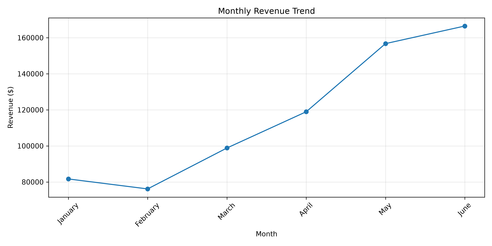
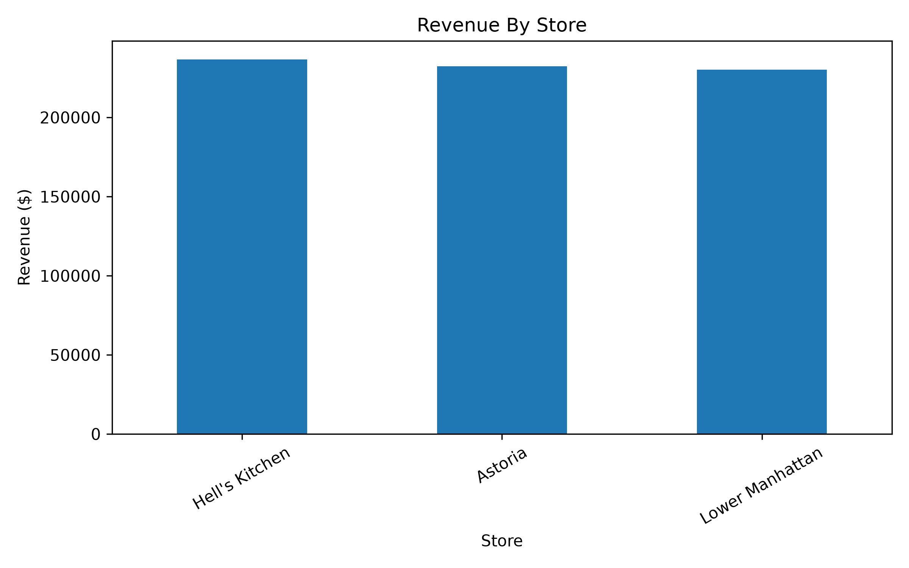
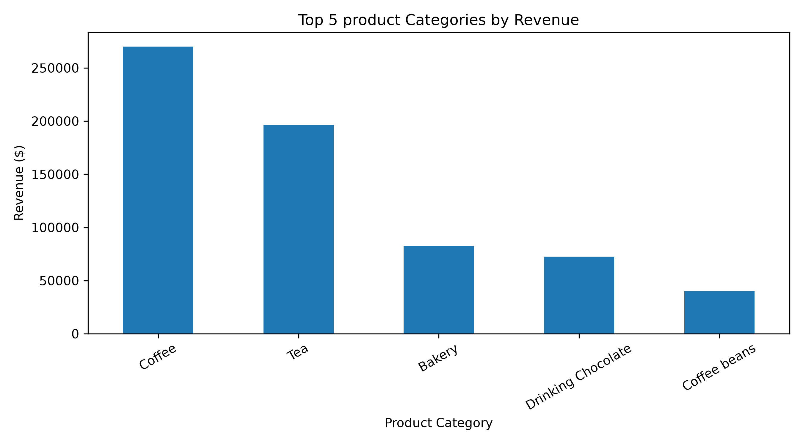

# Coffee Shop Sales Analysis

An exploratory data analysis project focused on understanding coffee shop sales performance using Python, Pandas, Matplotlib, and MySQL.

## Project Overview

This project analyzes **149,116 coffee shop transactions** to identify revenue trends, compare store performance, and understand product sales patterns. It combines Python-based data analysis and SQL queries to extract useful business insights from transactional data.

## Objectives

* Calculate total revenue, units sold, and transaction count.
* Analyze monthly revenue trends.
* Compare revenue across store locations.
* Identify top-selling products.
* Practice data analysis using Python and SQL.

## Tools & Technologies

* **Python** — Data analysis and calculations
* **Pandas** — Data manipulation and analysis
* **Matplotlib** — Data visualization
* **MySQL** — SQL-based analysis
* **Excel** — Source data format
* **Git & GitHub** — Version control and project hosting

## Key Metrics

| Metric                    |      Result |
| ------------------------- | ----------: |
| Total Transactions        |     149,116 |
| Total Units Sold          |     214,470 |
| Total Revenue             | $698,812.33 |
| Average Transaction Value |       $4.69 |

*Revenue is calculated as transaction quantity multiplied by unit price. Profit cannot be calculated because product cost data is not available.*

## Analysis & Visualizations

### Monthly Revenue

Shows how revenue changes across months.



### Revenue by Store Location

Compares revenue across the three store locations.



### Top-Selling Product Categories

Visualizes product categories to help understand sales performance.



## SQL Analysis

The SQL queries cover:

1. Total revenue, units sold, and transaction count.
2. Revenue comparison by store location.
3. Top 10 products by units sold.

SQL scripts are available in the [`Sql`](Sql/) folder.

## Project Structure

```text
coffee-shop-sales-analysis/
├── Sql/
│   └── sales_analysis.sql
├── .gitignore
├── main.py
├── import_sql.py
├── test_mysql.py
├── Monthly_revenue.png
├── store_revenue.png
├── top_categories.png
├── requirement.txt
└── README.MD
```

## How to Run

1. Clone this repository:

   ```bash
   git clone https://github.com/siddharth-gautam90/coffee-shop-sales-analysis.git
   ```

2. Open the project folder.

3. Install the required Python packages after they are listed in `requirement.txt`:

   ```bash
   pip install -r requirement.txt
   ```

4. Place the source Excel dataset in the expected `Data/` folder.

5. Run the Python analysis:

   ```bash
   python main.py
   ```

*MySQL analysis requires a configured MySQL server and the appropriate database and table setup. Database credentials should be stored locally and never committed to GitHub.*

## Author

**Siddharth Gautam**

* GitHub: [siddharth-gautam90](https://github.com/siddharth-gautam90)
* Project Repository: [Coffee Shop Sales Analysis](https://github.com/siddharth-gautam90/coffee-shop-sales-analysis)
